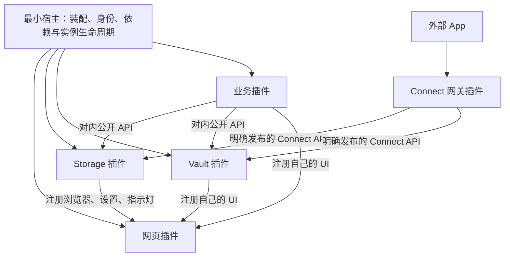

# WebLoom v4 需求与设计

> 2026-10-02 当前迭代：[插件服务模型与所属 UI 支持](#pcb-requirements)。本次仅修订文档，目标待实施；以 0.5.0 工作树为基线，先 WebLoom、后 Keymaster。以下第 1–14 节元信息与条款保留原 v4 历史范围。

- 状态：设计冻结修订；源码实施已开始，完成度待逐项验收。本文不声明现有工作树已经满足要求。
- 初稿：2026-09-09；本轮冻结修订：2026-09-10。
- 范围：WebLoom、keymaster.cc、DemoWebLoom 三仓一次性破坏性升级。
- 目标包：`webloom-framework@0.4.0`；从已提交基线 `0.3.0` 升级到 `0.4.0`；本轮迭代名称为 v4，包版本与协议版本独立编号。
- 目标 wire：唯一 `webloom.runtime.v1`；对应本轮 v4 / 包 `0.4.0`，不使用 `webloom.runtime.v4`。capability 自身的业务 `version` 独立于框架版本。
- 配套：[施工单](./implementation-plan.md)。本文定义“做什么、为什么、最终行为”；施工单定义“改哪里、顺序、如何证明”。

## 1. 用户授权与硬边界

本轮先交付需求文档与施工单，不执行程序修改、依赖升级、发布或部署。后续按施工单实施时必须满足：

1. 不兼容、不双轨、不保留旧 API 别名、旧 wire 分支、旧默认版本推导或运行时 fallback。
2. 三仓最终只消费 v4。开发分步骤可以临时编译失败，但不得把 v2/v4 并存作为交付状态。
3. 本文整体吸收 `shared-worker-call-first/SWCF-009-typed-transfer-follow-up.md`；typed-transfer 完整纳入本次 0.4.0，不再另留后续尾项。此前 v1/call-first 文档只用于历史与安全不变量参考，冲突时本文优先。
4. 原有用户工作树必须保留。WebLoom 和下游均须在继续施工前记录实际未提交修改；禁止 reset、整体覆盖、用旧 HEAD 替换工作树。
5. 破坏性升级针对框架 API、内部适配与 wire；不删除用户钱包数据，不改变 Hold 文件格式，不自动清空桶目录或生成新钱包。

### 1.1 本轮反馈裁决

| 反馈 | 裁决与冻结结果 |
| --- | --- |
| wire 从 v2 到 v1 | 保持用户指定的 `webloom.runtime.v1`。系统尚未上线；旧 v2 是前期开发迭代编号，不构成已上线 wire 的兼容承诺。迭代 v4、包 0.4.0、wire v1 是三个独立标识，不需要另起 family 或新增 epoch 字段。 |
| call.peer 权限不清 | 是真实缺口。普通 handler 得到独立 PeerView；管理对象仅属于可信装配/session controller，见 5.3。 |
| stream request transfer 遗漏 | 是正文遗漏，补齐 request + item，见 7。 |
| 任意对象图验证与清理 | 是实现约束缺失；采用有限 DTO 图与统一接收资源账本，不承诺遍历任意 JS 对象，见 7.1–7.2。 |
| deadline/quota | 有限 deadline 和 stream credit 原已要求，但默认值/其他上限未冻结；补齐 6.4。 |
| stream 终止组合 | 是状态机细节缺失；补齐 8.1 的竞态与 Promise 矩阵。 |

保持一个 hard switch。旧 wire 标记仅用于拒绝旧开发产物，不实现兼容解析。历史文档中的“v1/v2”不能覆盖本文完整 schema；不能仅凭相同的版本字符串跳过结构、身份或授权检查。

## 2. 当前基线与问题

历史 review 基线为 WebLoom `37817385006429014d1bde2cb5baec45ecff1345`（0.3.0）。2026-09-10 本轮核查：proposal 已提交于 `4d3a1f6`，工作树有大量未提交 v4 源码，且工作树 package.json **已为 0.4.0**。因此不能再从干净的 3781738 开始，也不能沿用“当前包还是 0.3.0”的反馈描述。

下游初次调查的 HEAD（Keymaster `e26ce6a085382088e7659aee13fa47c64024998b`；Demo `9be7e63e6504f2b4f41f26e46b266452d5c4a60c`）仅作历史定位，本轮没有重新验证下游完成度。继续施工以三仓当时的 HEAD + staged/unstaged/untracked 清单与内容为基线。

下面的问题列表描述历史 review 发现，不代表当前实现仍全部未修复；实施者应逐项对照现有修改补齐证据。本轮只修订文档，不运行程序测试。

历史 0.3.0 框架已经删除连接 hello/handshake、baseline/resync、连续 revision 与自动重连。v4 继承 call-first，不把这些机制恢复成连接前置门槛。

历史 review 的问题与本轮目标：

- capability 是字符串，调用者手填泛型，`RuntimeHandle.capability<T>()` 的 T 没有约束 call 请求/结果。
- 提供者、依赖者、调用者重复声明字符串和契约版本；普通 `definePlugin()` 有多套启动策略表达。
- 远程实现支持 function、object.handle、动态方法名三条分派路径。
- 主入口导出大量实现细节；`getProxy/requireProxy` 语义重叠。
- Keymaster 仍通过 `onConnection/onPortConnect` 读取 Runtime 裸端口，另开服务通道和 Local storage 页面回调通道；还有手工事件与 transferable 逻辑。
- React 主要订阅 Host 全局 version；诊断需要调用者拼接 state、graph、引用与错误。
- Review 复现的缺陷：取消后 pending 保留；对象方法丢失 this；result 克隆失败被吞成 timeout；矛盾 failed 快照仍放行已绑定代理。

Review 实验基线 107 项通过；删除 revision 防回退、目录验证、代理撤销、Provider 实例校验、cancel 均产生回归。删除 transport deadline/响应实例过滤虽然原测试全绿，补充探针证明有独立作用。v4 不以旧测试全绿为删减依据。

## 3. v4 目标与非目标

| 编号 | 必须交付的目标 |
| --- | --- |
| V4-R01 | 唯一 v4 API/wire、明确新旧隔离与三仓依赖闭环 |
| V4-R02 | typed local/RPC/stream capability，契约一次声明，输入输出端到端推导 |
| V4-R03 | 一个显式远程 handler 注册入口，运行时 parser 与声明访问检查 |
| V4-R04 | Runtime 私有端口上的双向、按 peer 隔离的能力调用与暴露 |
| V4-R05 | request/result/item transfer descriptor、所有权及错误语义 |
| V4-R06 | typed 事件流、有界背压、取消与旧订阅永久失效 |
| V4-R07 | 精简插件声明，静态描述与 realm 实现保持分离 |
| V4-R08 | pending 清理、失败状态、迟到结果、总 deadline 的可靠性修复 |
| V4-R09 | Scope 常见资源 helper，统一同步撤销与异步回收 |
| V4-R10 | inspect/explain、结构化错误、最小可观察指标 |
| V4-R11 | React 精确订阅与外部状态一致性 |
| V4-R12 | 主入口/advanced/react/testing 分层及类型消费验收 |
| V4-R13 | ready-only 紧凑完整快照、单次构建与广播优化 |
| V4-R14 | Keymaster 全部 WebLoom 引用、Coordinator/事件/Local bridge 硬迁移 |
| V4-R15 | Demo 01–09 全部更新、新 API 教学与真实浏览器行为验收 |
| V4-R16 | 测试矩阵、负向类型测试、消融回归和发布证据闭环 |

不新增通用自动重连/重放、跨设备 RPC、服务网格、持久事件队列、领域权限系统、完整日志平台。路由、钱包、Local/S3 存储实现、owner/session/CAS 继续属于产品。

## 4. 契约对象：唯一 capability 身份入口

### 4.1 三种明确形态

统一使用 `defineCapability()`，以 `kind` 区分行为；这是 capability 形态，不恢复旧 PluginMeta.kind。

```ts
// 所有接口字段必须附中文说明；下列为目标形状。
interface ValueParser<T> {
  /** 验证 unknown；成功返回 T，失败抛出校验错误。 */
  parse(value: unknown): T;
}

const Theme = defineCapability<ThemeService>({
  kind: "local", id: "ui.theme", version: "1",
});

const ReadProfile = defineCapability({
  kind: "rpc", id: "profile.read", version: "1",
  request: profileRequestParser,   // ValueParser<{ userId: string }>
  response: profileResponseParser, // ValueParser<{ name: string }>
});

const ProfileChanges = defineCapability({
  kind: "stream", id: "profile.changes", version: "1",
  request: profileWatchParser,
  item: profileChangeParser,
});
```

- `id` 与 `version` 必填且非空，精确匹配；删除 `${capability}.v1` 自动推导。
- local 类型由契约定义处指定；RPC/stream 类型从 parser 推导，消费端不得再次覆盖泛型。
- local 可以是对象/函数，不做结构化克隆，不能用于远程调用；远程消费 local 在类型层拒绝，运行时也拒绝伪造描述。
- RPC/stream request、response/item parser 为必需项；不接受“只写 TypeScript 泛型、不校验 wire”的远程契约。
- parser 不绑定 Zod 等特定库；泛型 parser 接口可以由产品适配现有生产 parser。
- 同一 `(kind,id,version)` 是共享契约身份，不依赖对象引用相等；运行时不能证明两份不同 parser 的语义等价，三仓必须导入同一业务契约模块。
- parser/transfer 函数留在各自 realm；manifest/wire 只含 `{kind,id,version}` 静态 DTO，禁止发送函数。
- 构建期生成 contract inventory：记录 kind/id/version、契约模块、parser 及依赖源码指纹、契约用例版本；同一身份冲突在构建时失败。parser 行为改变必须升业务 version；纯重构可在差异审阅和契约用例等价证据下保留版本。源码 hash 只提示变化，不证明语义等价；不使用 Function.toString 自动判定兼容，也不新增 wire schemaId/协商。
- 相同契约的两个 ready 提供者不得由“先找到谁”决定，Host 启动/目录接受必须明确报歧义。

### 4.2 提供、依赖、消费

```ts
const profilePlugin = definePlugin({
  id: "profile",
  provides: [ReadProfile, ProfileChanges],
  setup(ctx) {
    ctx.handle(ReadProfile, async (request, call) => {
      return loadProfile(request.userId, { signal: call.signal });
    });
    ctx.handle(ProfileChanges, (request, call) => {
      return observeProfiles(request, call.signal); // AsyncIterable<ProfileChange>
    });
  },
});

const consumer = definePlugin({
  id: "profile-panel",
  dependencies: [{ capability: ReadProfile, sourceRuntime: "shared-worker" }],
  setup(ctx) {
    const profiles = ctx.capability(ReadProfile);
    // profiles.call 的参数与 Promise 结果完全由 ReadProfile 推导。
  },
});
```

`ctx.provide(Theme, value)` 只注册 local；`ctx.handle(C, handler)` 只注册 RPC/stream。删除 object.handle/`{method,args}` 的框架反射分派，不为已有对象隐式绑定 this；下游用显式闭包适配对象方法。

`ctx.capability(C)`：local 返回对应值；RPC 返回 `RpcClient<C>`；stream 返回 `StreamClient<C>`。RPC 即使同 realm 也使用显式 Promise 边界与相同 parser/取消约束，但不伪造 MessagePort。

删除 ctx.get/has/require 的字符串版本，分别使用 `ctx.capability(C)`、`ctx.optionalCapability(C)`。local 必需能力缺失抛出结构化错误；RPC 获取始终惰性，只有 call/订阅 ready Promise 承担远端可用性失败。`optionalCapability` 是当前目录查询，返回 undefined 不代表未来永远不存在。

Host 必须检查：provide/handle 属于声明的 provides；消费属于声明的 dependencies 或本插件 provides。宿主引导注册使用 advanced 的显式 host-owned 注册入口，不借普通插件的身份绕过声明。

### 4.3 调用上下文

`RpcClient.call(request, {signal?, timeoutMs?, operationId?})` 不接受手工 request/result 泛型、不接受 transfer 数组。删除 `requestId` 作为 operationId 的兼容别名；领域 DTO 内自己的 requestId/commandId 可以保留其业务语义。

handler 的 `call` 至少包含：signal（取消）、deadlineAt（总截止时间）、operationId（业务操作 ID）、reference（当前服务绑定）、origin（local/remote 调用来源）、peer（仅由框架绑定且按调用者权限收窄的 PeerView）。远程调用 origin=remote 且 peer 必有值；同 realm 调用 origin=local 且无 peer，不能伪造一个连接身份。只允许远程 session.open 的领域 handler 必须检查 origin。peer 不是请求可覆盖的字段。未知错误统一收敛，不能把客户端自报 reference/owner/grant 当成权威状态。

## 5. Runtime、双向 peer 与暴露策略

### 5.1 用户可见的 Runtime 边界

保留 `createWindowApp()`（异步等待本地初始注册）、`connectSharedWorker()`（同步返回句柄）、`startSharedWorkerApp()`（在真实 SharedWorker 中创建唯一 Host）。不增加 RuntimeHandle.ready()。

- WindowApp：本地 capability、subscribe/state、inspect/explain、dispose；不在主入口暴露 `.host`。
- RuntimeHandle：远程 capability、subscribe/state、inspect/explain、dispose；不暴露 worker、port 或隐含 serviceBridge 属性。
- `dispose()` 返回本端清理结果；Window 连接 dispose 不意味着远端 Worker 整体退出。
- 自定义分阶段 Host 使用 advanced `createWindowAppFromHost({host,...})`，只接收 v4 Host，转移该 Host 所有权给 App，禁止同一 Host 被两个 App 拥有。普通 `createWindowApp` 删除 host 注入参数；两种装配复用同一个 v4 实现，不是兼容双轨。
- advanced `registerPlugins(app, definitions)` 与 `attachRemote(app, runtime)` 用于 Keymaster 的分阶段注册；同一 App 当前只关联一个 SharedWorker runtime。更换连接先同步撤销旧投影与旧 peer，再附加新句柄，不自动换绑旧代理。

### 5.2 双向连接的目标用法

```ts
// Window：先创建本地页面能力。远程依赖阶段不能阻塞这一步。
const page = await createWindowApp({ plugins: [localStorageBridgePlugin] });
const coordinator = connectSharedWorker({
  id: "keymaster-coordinator", url: workerUrl,
  client: { app: page, expose: [LocalStorageIo] },
});

// Worker：只有明确声明的能力对页面可见。
startSharedWorkerApp({
  id: "keymaster-coordinator",
  plugins: [coordinatorPlugin],
  expose: [SessionOpen],
  configurePeer(controller) {
    // 仅可信宿主装配可取得 controller；普通 handler 只收到独立 view。
    sessions.attach(controller); // host-owned，保存在私有闭包中
    controller.scope.onRevoke(() => sessions.detach(controller.view.peerId));
  },
});

// SessionOpen 的 handler 内，校验来源后调用同一页面暴露的能力。
if (call.origin !== "remote") throw new Error("SessionOpen requires a peer");
const local = call.peer.capability(LocalStorageIo);
await local.call({ /* 领域 lease 与 I/O 参数 */ });
```

- `client` 可省略，表示页面不暴露反向能力；不能为省略 client 创建第二套假 Window Host。
- WindowApp 必须先有可用本地 bridge handler，才能完成领域 session.open 中的首个反向 I/O。Keymaster 的其他阶段随后通过 advanced 注册，消除“等 Worker 就绪才安装页面 bridge”的循环。
- 每条物理端口只运行一套 v4 transport/provider/目录，每侧都可发起调用。callId 在连接、方向及存活期内唯一，两个方向的 pending 不共享关联键。
- Worker 的 `configurePeer(controller)` 同步安装 peer 级生命周期/策略；异步领域初始化通过 typed SessionOpen call 进行。它不是新的 hello 握手钩子。
- 普通 handler 的 call.peer 是 PeerView；configurePeer 参数是 PeerController。两者必须是不同运行时对象，权限与 SessionOpen 控制流见 5.3。
- `controller.expose(C, {scope?, attributes?, grantId?, authorizationRevision?, authorize?})` 暴露本 controller 管理授权范围内、已经在 Host 注册的 RPC/stream handler，返回幂等 revoke 句柄。调用的有效性同时受 provider scope、peer scope 与可选领域 scope 约束。
- `authorize` 在解析后、执行前调用，输入为框架绑定的 call context 与 typed request；允许异步，await 后框架再次检查 scope/binding。领域 handler 的最终 I/O fence 仍由产品负责，框架不会替产品验证 owner/CAS。
- 更新授权/属性必须 revoke 原 exposure 后新建，产生新的 serviceInstanceId。不能原地修改旧引用让旧代理继续有效。attributes 必须为可校验的无环数据，深复制/冻结后发布；不能通过外部对象别名修改授权指纹。
- grantId 若存在必须与该 peer 的当前 exposure 一致，再执行领域 authorize；不一致拒绝。缺省 grantId 也不能跳过该 exposure 已要求的领域授权。顶层 expose 只应用于产品确认无需 session 后置授权的 bootstrap/公开能力。
- 顶层 expose 是对每个 peer 应用相同的显式暴露策略，仍由每条连接形成 exposure；同一契约不得被顶层与 configurePeer 重复暴露。
- Window client.expose 与 Worker controller.expose 都只能暴露本 Host 的已注册 RPC/stream；对端声明本身不是认证，Local storage 操作仍检查领域 lease。
- 页面退出/连接 dispose 撤销该 peer 的 RPC、流和 exposure，不撤销其他页面，不销毁 WindowApp 的其他能力。

这条路径必须替代 Keymaster 主 Runtime 裸消息、附加 servicePort、LocalStorageBridgeWire 的框架传输与 pending 管理。不得把它们包装成 `rawSend()` 后宣称 typed 迁移完成。

### 5.3 PeerView / PeerController 与 SessionOpen 的管理权

| 对象 | 谁可以得到 | 唯一允许的能力 |
| --- | --- | --- |
| PeerView | 普通 RPC/stream handler 的 call.peer | 本连接 opaque peerId、已观察到的对端 runtime/runtimeInstanceId、PeerScopeView、按消费声明收窄的 capability(C) |
| PeerScopeView | PeerView.scope | 只读 state、signal、onRevoke(listener)；返回函数只能取消自己的监听 |
| PeerController | configurePeer、可信 host-owned session controller 私有闭包 | view、完整 peer scope、expose/exposeGroup、disconnect、管理 inspect；不得经 ctx.extension、handler 结果或 public facade 泄露 |

PeerScopeView 不含 revoke/dispose/child/track/acquire。`Readonly<LifecycleScope>` 仍可调用其变更方法，不满足要求。PeerView 也不能含 controller getter、symbol 后门、prototype 管理方法或可写的身份对象。必须创建真正独立且冻结的 facade，不能把管理对象 `as PeerView` 直接传下去。这是 API 权限收窄，不声称同 realm 任意不可信 JS 已被沙箱隔离。

peerId 是框架本地生成、连接期唯一的索引，不新增 wire connectionId，也不接受 request.peerId 替换 call.peer。runtime/runtimeInstanceId 表示**对端**，首次对端快照前可为 undefined，不能填写当前 Worker 的身份假装已观察到对端。

反向 capability 获取必须检查 handler 所属插件的依赖。采用显式 peer 依赖 `{capability: LocalStorageIo, source: "peer"}`，与原 sourceRuntime 形式互斥：peer 依赖在具体调用中解析，不进入全局 Host 启动依赖图；缺失时按该次调用的 deadline/错误语义收敛，不能用某个页面缺能力阻塞所有 Worker 插件启动。普通 ctx.capability 不可脱离 peer 上下文取这种能力。

SessionOpen 的实际授权路径冻结为：

1. 可信宿主创建私有 sessions controller；configurePeer 将 PeerController 登记到私有 live-peer 表。普通插件拿不到该表或 controller。
2. SessionOpen 是 host-owned 引导 handler，或在可信装配时注入私有 sessions.openForPeer 函数的受控 handler；此管理函数不进入通用 PluginContext/普通插件 facade。
3. handler 检查 origin=remote，使用框架注入的 call.peer.peerId 查询私有表，并验证调用绑定仍对应存活 peer；绝不使用 request 中的 clientId/peerId 寻找管理对象。
4. sessions 完成领域身份、lease、owner/session/grant 校验；await 后检查 call.signal、peer/领域 scope 与 generation。一个 peer 的 open/close/refresh 按会话世代串行化，过期 open 不得重新暴露服务。
5. 只允许 sessions 使用明确 allowlist（例如 owner/crypto）的管理权。`controller.exposeGroup(entries)` 先验证全部 entries/配额，再在同一同步提交步骤批量激活 exposure 和目录、生成一个 revision；失败不得部分开放。返回的组 revoke 句柄由该领域 session scope 持有。普通 expose 等价于一项 group，不增新 wire 消息。
6. 领域 session 状态与授权闭包先准备好，提交过程中不得 await；可调用目录最后发布。SessionOpen 的成功响应在提交之后发送。任何提交前失败清理暂存授权；响应丢失后查询既有 session/operation 状态，框架不重放。
7. lock/close/grant 变化/断开由 sessions 同步 revoke 已持有的 exposure group，再进入领域异步 drain。普通业务 handler 只能执行自己已获准的能力，不能触发任意 Host handler 的 exposure。

实现为独立管理对象后，现有代码中 `peer as CapabilityPeer` 这类仅收窄类型的传递必须消失。`authorize` 回调也只获得 PeerView，不向普通业务授权函数意外注入管理权。

### 5.4 身份与目录

| 身份 | v4 语义 |
| --- | --- |
| pluginId/unitId | 产品及运行单元稳定 ID |
| instanceId | 插件单元一次启动；共享 Worker 中多个页面观察到同一提供者单元实例 |
| runtimeInstanceId | 实际 WindowApp/Worker Runtime 一次启动 |
| serviceInstanceId | 一次可调用 exposure 的不可复用身份；按 peer 暴露可拥有不同 ID |
| callId | 一次传输调用，框架生成；不承担幂等 |
| operationId | 产品操作标识，框架透传但不自动去重或重放 |

两个页面共用 Worker 的证明是 runtimeInstanceId 与 unit instanceId、setupCount，不再要求两个 peer 的 serviceInstanceId 相等。

## 6. v4 wire、紧凑快照与单一错误入口

### 6.1 唯一 wire

固定类型前缀 `webloom.runtime`、协议 `webloom.runtime.v1`，删除可自定义 legacy codec/prefix。advanced 可实现严格 v4 transport，但不能保留 v2 codec 别名。

| type 后缀 | 用途与必需字段 |
| --- | --- |
| snapshot | 完整目录，见下文；双向对等发送 |
| runtime-error | 运行时初始化/协议失败：protocolVersion、code、message、phase、可选 pluginId/unitId |
| call | protocolVersion、callId、capabilityId、contractVersion、serviceInstanceId、mode、timeoutMs、request；可选 operationId/grantId；stream 另带 initialCredit |
| result | protocolVersion、callId、serviceInstanceId；unary 带 result；stream 以 `streamReady: true` 确认建立、以 `done: true` 结束，三种形状互斥 |
| error | protocolVersion、callId、serviceInstanceId、结构化 error |
| cancel | protocolVersion、callId、serviceInstanceId |
| next | protocolVersion、callId、serviceInstanceId、sequence、item |
| credit | protocolVersion、callId、serviceInstanceId、count |

mode 仅为 unary/stream。timeoutMs 为派发时剩余预算，必须有限正数；服务端以自己的时钟开始计时，消费者总 deadline 才是最终上限，不能依赖两个 realm 的绝对时钟完全一致。callId、serviceInstanceId、版本和消息形状都必须校验。旧协议只识别公共 type/protocolVersion 信封并拒绝，不加载旧 schema 或尝试降级解析。

stream 的调用 timeout 只约束建立阶段；建立后由 signal、scope、显式取消和背压控制，不套默认 30 秒总流寿命。具体 ready 确认见第 8 节。

不发送 connectionId、不传完整客户端 reference、不增加 hello/baseline/resync；业务身份放 typed DTO 或权威 exposure 元数据。

### 6.2 紧凑完整快照

外层：type、protocolVersion、runtimeId、runtimeKind、runtimeInstanceId、revision、state、units、services。

service 项：kind（rpc/stream）、capabilityId、contractVersion、serviceInstanceId、attributes、可选 grantId/authorizationRevision。不再重复 runtime/runtimeInstanceId/status。

- `services` 只包含当前可调用的 exposure。不可用服务直接移除；原因进入诊断，不发布 unavailable 服务项。
- 非 ready Runtime 的 services 必须为空；矛盾快照整份拒绝，不保留部分应用的目录。
- 接收端从外层恢复完整内部引用，不删除 runtime 身份检查。
- revision 是**同一 runtimeInstanceId 在当前 peer 的目录投影修订**，只要求本端口严格递增；允许跳号。不同 peer 的 revision 不用于跨页面全局排序。
- 本地 app.state 的 revision 是本地观察修订，不冒充所有 peer 的统一事务版本；领域 CAS revision 仍独立保留。
- 先原子验证完整目录，再同步更新 Provider/撤销，最后发布快照；不能先对外可见、再撤销旧实例。
- Host 公共状态每次变化构建一次不可变基础快照，再为各 peer 生成必要的 exposure 投影；不能给所有页面广播同一份含 grant 的目录。
- 旧/repeated revision 忽略且不能清空现有目录。Runtime 换代撤销全部旧绑定；显式重连创建新 peer，不隐式恢复旧代理。

### 6.3 错误

框架错误至少覆盖：protocol_mismatch、invalid_snapshot、capability_unavailable、contract_mismatch、request_validation_failed、response_validation_failed、request_clone_failed、response_clone_failed、transfer_invalid、handler_failed、call_timeout、request_cancelled、service_revoked、service_stale、transport_unavailable、runtime_initialization_failed、stream_overflow、resource_limit_exceeded、invalid_message。

公开 error 结构包括 code、message、phase（validate/wait/dispatch/execute/receive/dispose）、可选 capabilityId/runtimeInstanceId/serviceInstanceId、脱敏 details。phase 表示已观察到的失败阶段，不保证远端副作用未发生；发出请求后的 timeout 必须允许“执行结果未知”的诊断。

parser/异常堆栈及 details 不能携带完整 request、密码、密钥、存储凭据或 grant token。产品错误可以用命名空间 code，不能覆盖框架 code 的语义。

### 6.4 默认 deadline 与资源配额

这是首版确定的工程预算，不是测得的浏览器极限。quota 由可信 Runtime/advanced transport 装配的 `limits` 控制，默认值如下；不得由 wire、普通插件或单次 call 扩大。可信装配只能在本版上限内设置默认值或收紧配额；超过表中上限属于另一次显式设计预算修订，必须更新规范并重做边界/三仓大载荷验收，不能通过配置静默放宽。不允许 Infinity 或无上限。双方各自执行预算，超出对端预算直接失败，不新增协商握手。

| 项目 | 默认/固定上限与计量口径 |
| --- | --- |
| unary 总 deadline / stream 建立 deadline | 默认 30,000ms；每次 timeoutMs 范围 1–300,000ms；standalone 同规则；不静默截断 |
| peer 数 | 每个 Runtime 最多 32 个已接入 peer；超出只拒绝新 peer |
| pending call | 每 peer、每方向最多 64，含等待目录和 stream 建立；每 Runtime 各方向合计 512 |
| active stream | 每 peer、每方向最多 16（建立时预留）；每 Runtime 各方向合计 128 |
| 未完成 handler/iterator 清理执行槽 | 每 peer 最多 64，每 Runtime 合计 512；取消不等于执行已结束，见下文 |
| stream credit / push 队列 | 默认窗口 16、最多 256；适配队列最多同窗口项数，并同时受字节配额约束 |
| 单份 snapshot | 最多 512 units、1,024 services；此外仍受整条消息预算约束 |
| 单条消息 DTO 图 | 最大深度 32、10,000 个唯一对象节点、20,000 个字段/数组槽位边；重复引用不重复算对象但算引用边 |
| 单条消息预算 | 最大 16MiB budgetBytes，克隆与转移均计入；大文件以产品分块/stream 传输 |
| 保留载荷预算 | 每 peer、每方向 64MiB；每 Runtime、每方向 256MiB；涵盖等待派发、待回调 item、尚未释放的框架/执行槽载荷 |
| transfer | 去重后最多 32 项，其中 MessagePort 最多 8；extractor 原始列表也最多 64 项，超过即拒绝而非先无限去重 |
| 单服务 attributes | 深度 8、256 对象节点、1,024 引用边、16KiB budgetBytes；key 最多 128 UTF-16 code units，字符串值最多 2,048 |
| 标识符 | callId/peerId 最多 128；operationId/capabilityId/pluginId/unitId/runtimeId/runtimeInstanceId/serviceInstanceId/grantId 最多 256；contractVersion/protocolVersion 最多 64；都非空 |
| 其他文本 | 普通 DTO 单字符串最多 1,048,576 UTF-16 code units；对象字段名最多 256；错误公开 message 最多 1,024，details 最多 4KiB 且只含准许的脱敏标量字段 |

budgetBytes 是确定性计费值，不称为真实结构化克隆字节数：字符串与 key 按 UTF-16 长度 ×2；number/bigint 按 8（bigint 限有符号 64 位）；boolean/null/undefined 按 8；每个唯一容器 32、每条边 16；ArrayBuffer 按完整 byteLength（共享 backing buffer 只计一次），view 另计 32；Blob/File 按 size 加名称/type 文本；Date 16；MessagePort 64。所有项都累加，达到上限后立即停止遍历。数量边界用于补足字节估计，不能以短字符串填满无限对象图。

入站顺序：端口资源登记 → 有界信封/图/quota 检查 → 契约 parser → 身份/授权 → 执行。出口检查在 post 前完成；不合法本地 timeout 参数同步校验/Promise 拒绝，线上超限返回脱敏 resource_limit_exceeded。已确认身份的合法 call 遇到繁忙额度仅拒绝该 call；畸形/结构超限消息关闭该 peer 并清理其资源，不影响其他 peer。无法安全关联 call 时不得回显任意巨大的客户端字段。

配额预留和检查在同一同步步骤；计数有归属且幂等释放。stream 建立占 pending 并预留 stream slot，ready 时释放 pending、转为 active；不能在 ready 时才发现并发 stream 超限。cancel/error/done 后移除 pending/stream 表项；**不配合的 handler、next()/return() 或在途回调的执行槽及其已计费载荷，直到实际结束才释放**。因此 AT-05 要求 pending=0，但允许 inspect 报告 nonCooperativeExecutionCount>0；连续取消不能绕过执行上限。程序不能强制终止任意 JS Promise，达到该槽上限后拒绝该 peer 新工作，不新建无界“孤儿请求表”。

这些配额保护框架入站后的分配、保留与调度；浏览器在 JS 收到 MessageEvent 前已经执行了结构化反序列化，不能承诺阻止恶意原生 postMessage 的所有预分配，或为同 realm 恶意 parser/handler 提供 CPU/内存沙箱。不得把这项限制写成“任一异常页面绝不可能拖慢浏览器”的保证。

## 7. Transfer：契约决定所有权

RPC 契约可声明 `transfer.request(value)`、`transfer.response(value)`；stream 同样有订阅请求，必须支持 `transfer.request(value)` 与 `transfer.item(value)`。未声明则仅结构化克隆，call 不接受临时 transferForRequest/transfer 参数。

1. 提取器只能返回该载荷可达且类型允许的 transferable；发送前验证、去重、拒绝非法项。接收的 transfer 资源必须由明确的对应契约字段承载，不能把不在 DTO 内的 port 当侧信道。TypedArray 使用明确声明的 backing buffer，不能猜测任意视图的所有权。
2. sender parser 先验证规范化值，再基于该值提取 transfer，最后 postMessage；接收端再次使用生产 parser 验证。parser 不得在校验成功前执行 I/O。
3. 同一个 ArrayBuffer 的多个视图会共同失去原 buffer 所有权；文档必须说明，不能暗中复制子区间伪装零拷贝。
4. 发送前取消/验证失败不得 detach；成功 post 后取消不回滚所有权、不重发；结果到达前撤销也不允许绑定恢复。
5. 不承诺浏览器抛出发送异常后所有 transferable 均可再次使用；按实际所有权状态清理，不自动重试。
6. response/item 不可克隆时尝试发送仅含标量的结构化错误；不能吞错后让客户端等 timeout。错误发送也失败时由本端 deadline/连接状态收敛。
7. transfer 的 MessagePort 只能是业务显式声明的数据资源，绝不包含 WebLoom 自己的 Runtime 端口。必须声明接收方关闭责任；丢弃迟到结果时关闭已转移端口。
8. 取消、dispose、Worker 重启的迟到 buffer/port 不交给旧消费者。私密 buffer 的必要清零由产品契约/handler承担；框架不把未知业务字节写入诊断。
9. 不把同一 transferable 对象 fan-out 给多个订阅者；每个订阅拥有独立载荷所有权，或采用不可转移的克隆数据。

Keymaster Window P2P executor 等独立领域数据端口可以作为明确的 typed payload 转移，但其独立协议必须列入迁移清单并说明与 Runtime 控制协议的边界；不得保留 Coordinator 主 RPC/Local bridge 的旧端口作为“领域例外”。

### 7.1 支持的 DTO 图与统一验证器

```ts
interface StreamTransferDescriptor<TRequest, TItem> {
  /** 订阅建立请求的所有权转移。 */
  readonly request?: TransferExtractor<TRequest>;
  /** 每个流元素的所有权转移。 */
  readonly item?: TransferExtractor<TItem>;
}
```

一个共用 walker/validator 服务 sender、receiver、Provider 与 testing，不允许各自实现可达性近似版本。先检查原始输入图避免 parser 收到 accessor，再验证 parser 输出图，按**规范化输出**提取/匹配 transferable。parser 为受信任的同步代码，不应读网络、注册资源或自行 close/transfer；其返回不得偷偷丢弃或制造载荷的 MessagePort 身份。local capability 的任意本地对象不受 wire DTO 限制。

| 值/容器 | 规则 |
| --- | --- |
| 标量 | null/undefined/boolean/string、有限 number、64 位有符号 bigint；其余限制见 6.4 |
| record | 仅 Object.prototype 或 null prototype，遍历 own enumerable string 数据属性；拒绝 symbol、accessor、非枚举自定义属性，不执行 getter |
| Array | 只允许 length 与密集索引数据属性；拒绝洞、额外自定义属性、accessor；长度按边预算检查 |
| ArrayBuffer/TypedArray/DataView | 固定长度、非共享、未 detached；view→buffer 是显式可达边，按整个 backing buffer 计费/转移；不枚举每个字节 |
| Blob/File/Date | 作为受支持叶节点，读取内建 size/元数据或有限时间值；不遍历用户扩展属性；带自定义属性的值拒绝，不能藏嵌套 port |
| MessagePort | 叶节点，只允许显式声明且在 transfer list 内的业务资源；Runtime 自己的 port 永久禁止 |
| Map/Set、类实例、Error、函数、symbol、SharedArrayBuffer、可调整大小 buffer、其他平台对象 | 首版 wire DTO 不支持；产品调用点适配器在进入框架前先转成上述容器/错误标量 DTO（不能指望框架先把被禁止的 raw 值交给 parser）。不要无限扩大 walker 来模仿完整 structured clone |

允许 DAG 重复引用，拒绝循环；active-path 检测循环、visited 去重、节点/边/字节分别计数。深度是最长可达路径，缓存重复节点时也必须校验其子图深度，不能借别名绕过上限；实现采用有界迭代遍历避免递归栈溢出。

Proxy 不是受支持的 DTO。浏览器没有通用、无副作用的 isProxy 检查，getPrototypeOf/ownKeys/descriptor 自身也可能触发 Proxy trap。因此只承诺不主动调用普通对象 getter，不承诺检查任意本地恶意对象绝不执行用户代码；本地调用者/parser 负责提供受支持数据，最终浏览器 clone 拒绝仍映射为 clone error。入站数据以浏览器已克隆的值为基础；fake transport 必须遵守同样的输入前提，不把任意带 getter 的伪 MessageEvent 当真实 wire。

### 7.2 接收端资源发现与关闭责任

接收端在读取 data/parser 前，由 transport 记录 `MessageEvent.ports` 中本次新收到的 port。该数组包含本次转移的 MessagePort，即使业务图无法完整解析也能枚举；参见 [HTML MessagePort postMessage 算法](https://html.spec.whatwg.org/multipage/web-messaging.html#dom-messageport-postmessage)。允许的 raw DTO 图另用于验证这些 port 确实可达，集合必须吻合。不能仅在“成功解析出 request.port”后才开始负责清理。

- 每条消息的接收资源账本只有 transport 持有，不由各 parser 重复关闭。未识别消息、畸形/超限图、错版本/身份、未知 callId、取消后迟到 response/item、parser 或 authorize 失败：关闭该账本中所有尚未移交的 port，再丢弃载荷。
- 对合法但超出 transfer 数量上限的 event，也逐个关闭已收到 port；这是对本次已分配资源的清理，不创建与数量成比例的持久缓存。禁止靠递归扫描任意 data 发现这些资源。
- receiver parser 必须保持原始可达 port 集合；丢弃、克隆替换或添加 port 导致 transfer_invalid，并关闭本次资源。接收端提取器得到的 port 集合也必须与该账本吻合，避免未声明 port 被悄悄接受。
- handler 正式进入、unary result 交付调用者、item 开始调用 onNext 时，才移交相应业务 port 的关闭责任；排队 item 仍归框架。已移交的 port 不因框架后来取消就抢回关闭，业务使用本地 scope/signal 清理。
- MessageEvent 反序列化失败通常只有 messageerror，没有可访问载荷；只清理运行时确实拿到的资源与本端连接，不宣称能够关闭从未交给 JS 的 port。
- advanced transport 必须提供等价的“本次接收 port 清单”元信息与所有权移交；metadata 仅本地使用，不增 wire 字段。testing 必须模拟 data 与 ports 的同一对象身份。shared-worker connect 事件用于建立 Runtime 的 port 不属于业务消息资源账本。

## 8. Typed stream 与事件迁移

```ts
const sub = runtime.capability(ProfileChanges).subscribe(
  { userId: "123" },
  { onNext: async (item) => renderChange(item), signal, timeoutMs: 5_000 },
);
await sub.ready;    // 远端已建立订阅；不代表随后不会断开。
await sub.closed;   // 正常结束 resolve；错误/撤销 reject。
// sub.cancel(reason) 幂等，立即阻止本地新回调。
```

- stream handler 用相同 ctx.handle 注册，返回 AsyncIterable；所有 item 使用契约 parser。
- stream 建立使用 `result` 的 `streamReady: true`，不带 result/done；收到之后 ready resolve，建立 timer 取消。正常流结束使用 result/done；next 不能早于 streamReady。
- 初始 credit 固定默认 16，可在 subscribe 选项以 1–256 的整数收窄/调整；允许的窗口上限 256。每收到一个 item 消耗一个 credit；onNext 完成后消费者回补 1。两个方向分别计数；credit 必须为有限正整数，累计未消费额度不能超过订阅窗口，不接受重复补额使额度无限增长。
- sequence 从 1 严格递增；错序/重复、超 credit 的 next 终止该流。服务端无 credit 时不得继续拉取 iterator；不在框架维护无界队列。
- 将推送式事件适配为 AsyncIterable 时必须有有界队列，满时 stream_overflow 终止并要求产品重新订阅/取快照；v4 不静默丢事件、不提供持久重放。
- onNext 抛错/拒绝终止该订阅并发送 cancel；其余订阅隔离。handler 建立失败同时拒绝 ready/closed，框架给内部 Promise 安装处理以避免未观察的 ready/closed 产生额外 unhandled rejection。
- cancel/revoke/断线立即移除 pending 与监听器，停止本地回调，尝试 iterator.return()；不得等待不配合的 iterator 才回收框架记录。
- 长期流没有连接“仍活着”的保证；v4 不新增心跳。底层静默断开、缺少关闭通知时，产品需要自己的有界操作/会话策略；不能声称每次页面崩溃都即时被 Worker 发现。
- Keymaster 状态订阅必须在生产者同步建立监听与读取初始状态，保证快照和后续变化间没有丢失窗口；领域序号用于恢复检测，与 WebLoom stream sequence 不混用。

### 8.1 终止矩阵与竞态

状态为 opening → active → draining → closed/failed。ready 和 closed 各只能 settle 一次；以下 R(E) 表示以稳定脱敏框架错误拒绝，F 表示 resolve。cancel/失败先于最终 closed settle 时优先终止；已 settled 的 Promise 不被改写。

| 事件 | ready | closed | producer iterator.return()/资源 |
| --- | --- | --- | --- |
| ready 前主动 cancel 或外部 signal abort | R(request_cancelled) | R(request_cancelled)，立即 | 若已有 iterator，最多调用一次 return；稍后才创建则一到达就 return，不发送 ready/item |
| 建立 deadline 到期 | R(call_timeout) | R(call_timeout)，立即 | abort + 一次 return；不等待其配合 |
| handler 建立失败/订阅授权失败 | R(对应错误) | R(同错误) | 已取得 iterator 则异常回收一次 |
| producer 已有 iterator，但 streamReady post 失败 | 消费端收到可发送的 error 则 R(transport_unavailable)，否则由建立 deadline/断线拒绝 | 同左；不能声称对端立即知道发送失败 | producer 立即取消建立 timer、释放 pending，abort 并一次 return；不能开始 next |
| 正常收到 streamReady | F | 保持 pending | producer 才可发送 next；建立 timeout 取消 |
| active 时主动 cancel | 保持 F | R(request_cancelled)，立即 | 停止新回调、丢弃/清理排队 item、abort + 一次 return |
| onNext 执行时 exposure revoke/断线 | 已 F 则保持 F；未 ready 则 R | R(service_revoked/transport_unavailable)，立即 | 当前 JS 回调不能强行终止；不再派发下一项、不补 credit；return 一次，执行槽直至实际结束 |
| onNext 抛错或 Promise 拒绝 | 保持 F | R(handler_failed)，立即 | cancel 对端、清理排队 item、return 一次；不公开回调原始异常内容 |
| 收到 done，存在未完成回调/已接收 item | 保持 F | 进入 draining，按序完成全部已接收 item 后 F | done 后不接收新 item；正常 iterator 已耗尽，不再重复 return；排队资源逐项移交 |
| draining 时 cancel/revoke/回调失败 | 保持 F | R(对应错误)，不等剩余回调 | 丢弃未交付 item，已移交资源由业务负责，晚到回调完成不改写失败 |
| ready 前收到 done/next、错序/超 credit | 未 ready 则 R(invalid_message)，已 F 不改写 | R(invalid_message)，立即 | 终止本流并清理；若无法安全关联则关闭 peer |
| closed settle 后任何消息/重复 cancel | 不变 | 不变 | 丢弃迟到载荷并关闭其未移交 port，不重复 return |

一个订阅的 onNext 串行执行，最多一个回调在执行；其他已收到 item 在窗口/字节预算内排队。done 仅意味着生产结束，不代表消费完成；draining 不再给 producer 发 credit。若回调永久不结束，closed 在正常 done 路径可以保持 pending，调用者仍能 cancel；不能暗中套回 30 秒流寿命。

return 的调用结果必须有 rejection handler，不产生悬空 unhandled rejection；正在执行的 next()/return() 不强制中断，其资源槽按 6.4 保留。正常 done 之后 consumer 的错误无需再次调用已自然结束的 producer iterator。

`cancel(reason?: string)` 仅供本地调用者关联操作，长度最多 256；不写入 wire、公开 error.message/details、inspect 或日志，公开错误使用固定 request_cancelled 文案。外部 signal.reason 同样不直接序列化；不存在用任意 Error/object reason 跨端传播私密信息的入口。

## 9. 插件声明与公共 API 收口

普通 `definePlugin` 保留 id/name/description、runtime/unitId、provides、dependencies、permissions、config、contribution、startup、defaultEnabled、canDisable、setup。

- 删除 required、meta、providedContracts。唯一启动表达是 startup: required/optional，默认 optional。
- required 固定初始启用且不可停用；若显式给出矛盾 defaultEnabled/canDisable，在任何 Host mutation 前拒绝。optional 默认启用且允许停用，可显式调整。
- 领域分类、bootstrapStage、scopeKind 放类型化 contribution/领域装配配置，不能恢复可任意覆盖的 meta 逃逸口。
- 单 runtime 省略 runtime 时只在装配层补齐一次。advanced 的多 unit descriptor 仍是 v4 契约，必须选定实现 unit，不保留旧顶层/units 同时为真值的规则。
- 静态 descriptor 不含 setup/parser/transfer 函数；装配层维护契约实现表，序列化只能使用静态投影。

| 现有入口 | v4 唯一替代 |
| --- | --- |
| 字符串 provides/dependencies/provide/get/useCapability | 契约对象；ID 字符串仅用于序列化/诊断 |
| capability<T>(string)、call<TRequest,TResult> | 契约推导的 capability(C).call(request) |
| getProxy/requireProxy、隐含 serviceBridge | Runtime/Context/Peer capability(C)；advanced 内部同样只用一个获取入口 |
| function/object.handle/{method,args} RPC 猜测 | ctx.handle(C, explicitHandler) |
| onConnection/onPortConnect | client.expose、configurePeer(PeerController) |
| PluginHostProvider/useHost 兼容出口 | WebLoomProvider app + typed hooks；advanced 显式 Host 工具 |
| 主入口 export * 底层实现 | 四入口白名单，见下文 |

主入口：defineCapability、definePlugin、三个 Runtime 构造函数、App/Handle/契约/错误/Scope 必需公共类型。

`/advanced`：v4 Host/graph/registry、分阶段 App 装配、领域扩展、权限租约/UpgradeGate、strict-v4 transport 扩展。只移动职责，不复制实现，不支持旧签名。

`/react`：WebLoomProvider、typed capability/resource/plugin hooks 与 selector。

`/testing`：真实生产 parser 驱动的 harness、可控端口、时钟/调用与流观测、类型测试帮助。workerFactory、测试全局 scope 注入不进入生产 options。

现有 Resource/MessageBus 的独立业务语义不整体重写；使用新的 typed capability 获取它们，底层配置与扩展工具放 advanced。删除的是兼容分支，不是所有高级能力。

## 10. 生命周期与四项缺陷修复

### 10.1 调用状态

内部统一状态：waiting → dispatched → settled；任何阶段可进入 cancelled/revoked/timed-out。只有一次 terminal transition。pending 数量在本端终止后必须立即减少，不等待业务 Promise 结束。

- cancel、目录替换、Provider revoke/dispose 都同步移除对应记录并 abort，异步 handler 的 finally 使用记录对象身份检查，不能误删后续记录。
- 保留必要的迟到结果 fence；把重复实现抽成同一 settle/revoke helper，不因 A7 全绿就同时删 signal 与 binding 检查。
- Bridge 总 deadline 包括目录等待；独立 transport 也必须有有限 deadline。可复用一个 deadline 控制对象，但公开 standalone 路径不能失去保护。
- 非 ready 目录约束统一；failed/stopping/disposed 同步撤销已绑定代理及所有流。
- result/parser/clone 失败直接返回对应结构化错误；不伪装调用成功。
- 远程 object 方法分派删除后，依赖 this 的对象必须通过显式闭包调用；验证迁移后的对象方法仍正确。

### 10.2 Scope helper

新增 `scope.listen(target,event,listener,options?)`、`scope.interval(callback,ms)`、`scope.subscribe(subscribeFn,listener)`，返回幂等 release 函数，全部基于现有 Scope track/onRevoke/onDispose。

listen/interval/subscribe 在 revoke 时同步解绑/停止调度；不可阻止已经进入业务代码的回调，但不得再派发新回调。interval 只接受同步 callback；异步后台任务使用现有 scheduler，避免隐含重入策略。

subscribeFn 形如 `(listener) => unsubscribe`，同步安装时如发生 Scope 撤销或同步回调重入，获得 unsubscribe 后必须立即清理。已撤销 Scope 注册一律拒绝且不遗留资源。

保留 acquire 的异步创建后补撤销语义；不另起 ResourceManager。文档纠正 track 当前返回资源本身而非“释放句柄”的注释歧义，v4 track 继续返回资源，不增兼容 overload。

## 11. 诊断、React 与性能

### 11.1 inspect/explain

App/Handle 提供不可变的 `inspect()` 与 `explain(pluginId | contract)`。结果包含插件/单元/Runtime 状态、依赖阻塞原因链、引用身份、scope 状态，以及 pendingCallCount、activeStreamCount、peerCount 等本端指标。

诊断字段必须注明 provenance：local（本端事实）、remote-projection（最后接受的对端可见投影）；远端项附 runtimeInstanceId/revision、observedAt（本端接收时间），不称为对端当前实时权威状态。断开后的历史信息标 stale；本端执行槽/计数不能冒充对端内部计数。

PeerView 不提供 Host 管理 inspect。客户端看不到的服务，其 missing 与未授权统一为 capability_unavailable，不返回“存在但你无权限”、实际版本列表或隐藏 provider 信息。只有客户端已见到的 exposure 才可解释其已见版本不匹配/撤销；runtime-error/错误 details 不得绕过此规则。units/graph 的远端投影也只含宿主明确公开的单元，不能通过完整 unit 清单旁路隐藏能力策略。可信本地 App/PeerController inspect 可以查看自己管理的本地状态，但不能默认向 peer 发送。

本地管理原因码至少覆盖 missing_provider、contract_mismatch、dependency_blocked、scope_revoked、runtime_disconnected、initialization_failed。原因链循环截断，确定性排序；不存在的 ID 明确 unknown，不返回伪成功。

诊断从现有状态与计数派生，不维护第二套权威生命周期，不暴露 request/result、密钥、密码、grant token、授权 headers。peerCount 不宣称等于仍活跃浏览器 Tab 数。

### 11.2 React

- `WebLoomProvider({app})` 提供稳定 App 引用，不维护无意义全局 version state。
- `useCapability(C)`、`useOptionalCapability(C)` 类型从契约推导；RPC/stream 代理稳定到对应 exposure 生命周期，不在每次 render 新建，也不让旧代理偷偷换绑。
- 提供 `usePluginState(id)`、`useRuntimeSelector(selector,isEqual?)`；capability 订阅按契约身份更新，插件订阅按 pluginId 更新。
- 外部状态读取和订阅使用能正确处理提交前状态变化的实现，推荐 useSyncExternalStore；snapshot 引用在无相关变化时稳定。Host/App 切换必须同步读新状态，卸载删除订阅。
- required local 缺失可交错误边界；optional 返回 undefined。组件不能因构造远程代理就抛“Worker 未就绪”。
- 验收以“无关 capability 变更不增加消费组件 render 次数”证明订阅精度，不能仅凭代码改成 selector 就宣称优化。

### 11.3 快照性能

一次 Host 变更只构建一次公共基础快照；peer 的私有投影分别生成；禁止为了优化合并授权状态。用 1/10/100 服务、1/2/10 peer 的构建次数、序列化样本大小、pending/订阅数量验证，不以 JSON 字节数冒充 MessagePort 内存/吞吐。

## 12. Keymaster 迁移要求

### 12.1 架构落点

- `packages/contracts` 声明 typed local/RPC/stream 契约及生产 parser；业务 kind/request/result 联合保留明确对应关系。禁止把几百个请求退化成 `unknown → unknown` 总入口。
- `keymasterSessionCoordinatorClient.ts` 保留产品 facade 与明确的产品重连策略；删除手写主 RPC pending、raw post/listener、附加 service bridge、LocalStorageBridgeWire 请求关联。
- `keymasterSessionCoordinator.worker.ts` 的领域处理函数逐项通过 ctx.handle 注册；事件通过 typed stream；主端口由框架独占。
- 为 localStorage 页面 I/O 创建 Window RPC handler，Worker 通过 call.peer 对准提供 lease 的那一个页面调用。不得自动挑选“任意有 LocalStorageIo 的页面”。
- session.open/close、活动上报、bootstrap refresh 都是 typed RPC；领域 session.open 可以保留租约/身份建立语义，但不能再传 servicePort/localStorageBridgePort。
- owner/crypto exposure 在 session 授权后按 peer 显式暴露；ready-only 目录移除不可用项，脱敏状态由 typed 状态流/diagnostics 提供。
- keymasterHostAdapter 迁到 v4 advanced，保留贡献与领域 scope 适配，不再把 v2 字符串签名翻译给 v4。Keymaster 业务 API 名称可保留，但内部不能形成旧框架代理层。
- 所有插件 manifest、capability 获取、React hooks、test fake 一并迁移，不以入口编译通过代替全库迁移。

### 12.2 不可退让的产品不变量

Local 桶是 Window `localStorage`，不换 IndexedDB；先选择/导入桶，再选 Key。保留 Root/owner/session epoch、bucket generation、grant/授权 revision、authority CAS、handover generation、durable/final-I/O lease 与 UpgradeGate 顺序。

普通插件继续获得绑定 manifest/实例权限、不可修改的领域 facade；typed 契约不等于扩大权限。不得重新向普通插件暴露全局 Coordinator、storageBindOwner、owner 删除等内部控制能力；这些 handler 的契约归属、消费声明、exposure 与最终授权必须同时收窄。

业务异步边界前后及最终写入前仍校验，同步 revoke 先于 drain。初始化事务仍先构建完整 Hold 候选，catalog/CAS 最后可见；恢复记录使用生产 parser。不得为通过 v4 测试放宽非法恢复状态。

旧页面/旧 Worker 与 v4 不混用业务调用。采用 build 隔离的 Worker 产物与名称，不共享旧 wire；新 Worker 不能因新名称就绕过 authority 接管。发现旧最终 I/O lease 未释放时仍进入 recovery-required，不能强抢或清空账本。

产品可在断线后显式重建 Runtime/重开 session/重订阅；不自动重放已经发送的写入、签名或交易。响应丢失走已有 operation/transaction 查询或恢复流程。

## 13. Demo 迁移要求

保持 01–09 递进结构：01 最小插件；02 typed local capability/依赖；03 Scope helper 与清理；04 本地 MessageBus；05 Resource；06 权限；07 typed SharedWorker RPC/stream/transfer；08 UpgradeGate；09 advanced 领域装配。

所有示例去掉字符串 capability、手写调用泛型、providedContracts、required/meta、旧主入口底层 import。同步修改页面代码摘录与说明，禁止运行代码新、教学文本旧。

07 必须演示请求结果推导、实际 transferable 所有权变化、取消、两个页面共用 Worker 单元实例、旧代理/订阅失效，以及 typed 页面反向能力。仍使用实际生产构建 SharedWorker URL，不能用 MessageChannel fake 代替浏览器验收。

### 13.1 浏览器验收口径

本轮必须在生产构建的真实 Chromium 完成完整矩阵，并记录精确版本/平台；这只是已验收支持范围，不意味着所有浏览器自动受支持。Firefox 与 Safari/WebKit 要有明确记录（实际版本、module SharedWorker/双向 transfer/stream 测试结果或未验收），不把 Playwright WebKit 直接写成真 Safari 已通过。

框架按所需特性检测返回明确 unsupported/transport_unavailable，不增加 DedicatedWorker、MessageChannel 或 Window 假 Runtime fallback。其他浏览器未通过时不得宣传“全浏览器验收完成”；若产品发布承诺包含它们，相关真实环境必须成为该产品发布门禁。本文不以 Chromium fixture 代替产品的浏览器支持决策。

## 14. 验收及发布定义

完成须满足全部 V4-R01–R16，对应施工单矩阵。测试覆盖分层报告：类型、单元/模拟、生产构建真实浏览器、三仓 tarball、registry 消费、产品外部/恢复验收。某层缺条件必须标未完成，不能由前一层替代。

发布前在隔离消费目录使用同一份 v4 tarball 测三仓；最终 Keymaster/Demo 精确依赖 `webloom-framework: 0.4.0`，lockfile、peer/dev 依赖、release checker、minimumReleaseAgeExclude 同步更新。不能留下 link/file、本地绝对路径、0.3.0 与 0.4.0 双份解析。

npm 上传前必须检查目标版本可用；若 0.4.0 已占用，发布步骤停在版本决策处，不能覆盖/静默改为兼容版本。registry 发布后必须从 registry 验证同一产物 integrity，并做消费者验收。发布与部署是后续实施交付步骤，本轮文档编写不执行。

旧 release 文档/教程要标明已被 v4 替代；历史记录可保留历史字符串，生产代码、公共 d.ts、示例与活跃消费文档不得残留旧 API。禁止靠删除回归测试或弱化安全断言完成 hard switch。


<a id="pcb-requirements"></a>
<a id="plugin-service-requirements"></a>

## 15. 插件服务模型与所属 UI 支持（2026-10-02 修订）

- 状态：已有实现与历史验收证据保留；本次复核仍有计划内阻断项，见施工单 8.11。新增完整插件/多 Worker 支持（PSM-R11–R13）仅完成需求，待实施。下游迁移、跨浏览器与发布未执行。
- 源码基线：`webloom-framework@0.5.0` 工作树（含上一波未提交修改）。破坏性版本确定为
  `0.6.0`，未发布。
- 配套：[施工单第 8 节](./implementation-plan.md#plugin-service-plan)。既有需求为 PSM-R01–PSM-R10；本次新增 PSM-R11–PSM-R13，单独验收，不以旧证据冒充完成。
- 优先关系：本节替代原第 15 节 PCB 需求。第 1–14 节是原 v4 三仓迭代历史范围；其中启停策略、迁移顺序及发布目标不适用于本轮。既有 typed capability、transport、scope 与最终授权的安全约束继续保留。
- 顺序：WebLoom 先提供可验收的框架契约与产物，Keymaster 再逐层迁移。本轮文档编写不修改程序、下游依赖或发布部署。

### 15.1 目标关系与职责

所有业务单元统一称为插件，按服务依赖形成有向无环图。WebLoom 不替产品划分 core/platform/business 等等级，也不把依赖层级当成权限等级。



箭头中的服务依赖必须显式声明；宿主的装配箭头不是业务依赖。网页插件只负责布局与挂载，注册过来的 Storage UI 仍属于 Storage 实例。Connect 网关的协议、App 授权与方法名单由产品插件实现。

| 插件的接口面 | 使用者 | 边界 |
| --- | --- | --- |
| 对内公开 API | 其他插件 | 发布 typed capability，消费方声明依赖，Host 绑定调用实例 |
| Connect 公开 API | 外部 App，经网关调用 | 明确发布方法与调用者范围，不能自动继承对内全部能力 |
| 私有 API | 插件自己的实现及自己的 UI | 不登记为公共 capability，不交给其他插件解析；可使用私有 Context、闭包与内部模块 |

这三项是访问面，不是必须建立三个 Runtime 或三份服务对象。RPC/local/stream 描述传输形态，不表示对内、对外或私有。需要跨 realm 的私有调用必须经受信任的所属关系适配，不能通过全局暴露或冒充 pluginId 实现。

### 15.2 PSM-R01 · 框架与产品分工

WebLoom 负责 typed 依赖核对、受信任实例身份、消费视图、通用作用域注册机制、资源归属、跨 Runtime 暴露及销毁。保留 core/advanced/react 分入口，核心无 React、钱包和 Connect 协议依赖。

产品负责网页插件与注册条目 schema、各插件私有 API/Context、对内服务的领域范围、Connect 网关的 App 身份与授权、最终 I/O 检查，以及源码 import 门禁。WebLoom 不内置 `registerPage`、`registerHeaderItem` 或 `savefile` 等产品契约。

例如 Storage 对内 `savefile(plugin, path, data)` 映射到 `/pluginId/path`，Connect `savefile(app, path, data)` 映射到 `/apps/appId/path`。这里的 plugin/app 必须来自受信任的绑定身份，不能直接相信调用者传入的字符串。路径是产品逻辑视图，不规定底层存储格式。全局浏览器通过 Storage 私有 API 读取，不新增全局读取公共 capability 来满足自己的 UI。

同一 JS realm 的内置插件仍是可信代码。本轮是框架入口及生命周期约束，不是任意 JavaScript 沙箱；不承诺阻止插件直接导入其他源码或复制已有数据。

### 15.3 PSM-R02 · 全部登记与依赖驱动生命周期

- 产品装配清单中的插件全部默认参与系统，不再存在用户 enable/disable 意图及其持久化状态。
- 启动与计划销毁由已声明并完成提供者绑定的依赖图决定，不依赖清单顺序、手写 priority 或插件分类。若 A 依赖 B、B 依赖 C，启动顺序为 C → B → A；销毁顺序为 A → B → C。互不依赖的分支允许并行。
- 提供方完成初始化并发布所需能力后，依赖者才可启动；不能把“已登记”当成“已可用”。缺失必需依赖、循环或初始化失败必须显示等待/错误原因。
- 计划替换/销毁提供者时，先阻止受影响依赖者的新业务调用，再按反向依赖顺序清理依赖者，最后释放提供者。共享提供者不得因销毁一个消费者而被连带销毁；只清理本次操作确定的实例集合。
- 提供者意外失效时不能保证物理销毁顺序，但必须立即撤销失效调用路径，处理必需依赖者，再执行幂等清理；恢复仍按正向依赖顺序建立新实例。
- 可选依赖未绑定时不形成启动等待；已绑定时纳入顺序和句柄清理。可选提供者失效通知消费者降级，不自动销毁整个消费者，旧句柄仍必须失效。
- 移除插件 manifest 的 `startup`（旧启动分类）、`defaultEnabled`（默认启用）、`canDisable`（允许禁用）及相关类型、Host/React 启停接口、意图控制器和启停专用配置存储。WebLoom 不新增 `kind` 分类。
- 状态反映依赖等待、实例运行、销毁与失败。对外服务可用性单独表达为可用/不可用及原因；不得以 enabled/disabled 或 desiredEnabled 继续表达旧产品意图。
- 保留 scope 创建/撤销、dispose、实例重建、依赖消失处理、取消、失败诊断与可信宿主的装配清理。插件始终登记，不意味着钱包永远解锁，也不意味着网络连接和所有后台任务立即执行。
- 可选依赖缺席不阻塞独立功能；必需依赖缺席时该运行单元不可用。失败不得伪装成可用，也不得因一个非启动关键服务失败无差别停掉整张图。
- 结构错误（循环、非法契约、无法确定的提供者）在装配时明确拒绝。领域运行条件（锁定、账户切换等）由产品权威适配驱动实例/服务可用性，不恢复持久化启停意图。
- 同一服务存在多个实现时，装配必须明确消费方绑定的提供者或服务槽。候选登记不等于同时抢占同一能力；不能靠用户禁用其余插件消除歧义，不能静默选择第一个提供者。
- 不自动重放签名、广播、保存等业务副作用。Host 重建的是实例与合法注册，不是历史业务请求。

启停专用配置移除不影响插件业务设置。快照中的用户意图字段同步移除；若序列化 schema 改变，必须同步契约、两端投影与版本校验，不能宣称本轮必定零 wire 变化。RPC/stream/transfer 传输机制不因本模型重写。

### 15.4 PSM-R03 · 对内服务的实例消费视图

保留上一波 `PluginConsumer`（实例消费视图）和 `ctx.consumer`（当前实例视图），复用 Host 的统一依赖解析。

| 字段/方法 | 中文说明 |
| --- | --- |
| `pluginId` / `unitId` / `instanceId` | 诊断用插件、运行单元、实际实例标识；不能用来申请另一个身份 |
| `capability(C)` | 获取声明的依赖或自身已公开的 typed 能力 |
| `optionalCapability(C)` | 已声明但当前缺席时返回 undefined；未声明、契约错误及撤销仍拒绝 |
| `subscribe(listener)` | 订阅能力/实例有效性变化，返回退订函数，复用 Host 状态 |

视图必须由 Host 为真实实例签发。禁止公开 `consumerFor(pluginId)`、任意 scope 构造身份或按结构接受伪造视图。所有解析先检查实例有效性，再核对 kind/id/version 与绑定来源；setup、UI、资源不维护三套规则。

**先声明，才能使用**：跨插件依赖以具体 typed 服务契约及其提供者绑定为准；只声明依赖某个插件名称，不等于可以使用它的所有服务。A 即使已经登记并运行，B 未声明 A 的对应服务，也必须拒绝获取、探测、订阅或调用该服务。不得自动发现后补依赖、隐式继承传递依赖，或因同 realm、内置服务、UI 注册、资源加载而免检。B 依赖 A、A 依赖 C，不代表 B 可以直接使用 C。

未声明与已声明但缺席是不同错误：optional/has 只处理后者，不能把未声明调用变成 undefined/false。拒绝必须发生在返回服务句柄和执行业务 handler 之前，并给出消费插件/运行单元、请求契约及未声明原因。

框架正式入口执行运行时检查；产品构建/import 门禁拒绝跨插件私有实现导入、裸服务单例和全局 Host 注入等绕行。类型校验作为补充，不代替运行时检查，也不声称 Host 可以拦截任意直接 JavaScript 调用。插件访问自身私有实现不属于跨插件依赖。

Consumer 不含完整 Host/App、根 scope、调度器、身份切换或用户启停接口。业务写方法经已声明 capability 正常调用；“消费”不等于业务只读。带副作用的 local 服务需要所属作用域 facade 或提供方有效性检查。

### 15.5 PSM-R04 · 插件自己的 UI 与私有 API

插件可以有页面、设置块、header 指示灯及多个其他 UI 接口。它们共享所属插件的私有实现，不增加逐组件权限表，不把私有 API 强制转成 `provides`。

- 自己的 UI 通过作者定义的私有 Context、闭包或内部模块访问私有服务；通过 consumer 获取公开能力。两条通道并存。
- 不再要求“完整 ctx 只能在 setup 同步期间使用”。涉及框架操作的上下文/句柄以实例 scope 有效期为准；禁止把根 Host/App 作为私有上下文的通用后门。
- 框架无需理解私有 Context 的字段。内部对象持有的异步任务和 I/O 由该插件绑定实例生命周期及领域授权。
- 自有 UI 不需要为访问自己的 API 再声明一组权限；跨插件服务仍必须声明依赖。私有模块的源码边界由产品 import 门禁约束。
- 提供方导出的共享组件保留提供方的 consumer 与私有 Context。消费方只获得明确公开的组件入口，父组件不能借此取得提供方的私有服务。
- 实例撤销后，其 UI 注册与 Provider 子树撤下，旧 consumer 永久失效。普通闭包/已复制对象不是自动可撤销对象，不以 UI 卸载代替最终 I/O 检查。

### 15.6 PSM-R05 · 网页插件注册与挂载

网页插件向其他插件提供 typed UI 注册服务，定义页面/设置/header 的结构、排序与渲染。WebLoom 复用并完善 `createScopedRegistryFacade`（作用域注册门面）及贡献适配，不引入第二套 UI 注册状态机。

1. 身份由 Host 的实际调用实例绑定；服务提供方得到受信任注册归属，不能信任条目中的 owner/pluginId 字符串。
2. 动态注册与静态 `ContributionAdapterInput.consumer` 绑定同一实际贡献实例。注册门面支持拥有者限制、撤销清理及迟到注册拒绝。
3. 网页插件保存已绑定的组件入口/回调；挂载时使用贡献方 consumer，组件内部保留贡献方私有 Context。不得替换成网页插件 consumer。
4. 网页插件无需拿到 Storage 的私有对象。注册一个闭包组件，不等于向网页插件公开该闭包持有的所有内部对象。
5. 注册、更新、注销检查所属实例；越权操作拒绝。撤销移除旧条目，异步注册晚到不能复活旧实例，同名新实例不能被旧清理误删。
6. 网页插件不声明 Storage 等业务依赖来反向获取其私有实现，避免“业务依赖网页、网页又依赖业务”的循环。由注册条目完成渲染衔接。

Consumer 不会自动把任意 local registry 对象变成安全门面。框架必须提供并验证可信绑定的通用接入路径；产品实现条目 schema 与挂载适配，不能只靠文档要求自行填写可信身份。

### 15.7 PSM-R06 · React 入口

保留 `PluginConsumerProvider` 与 `usePluginCapability`、`useOptionalPluginCapability`、`useHasPluginCapability`，仅在 react 子入口导出。

- Provider 只接受框架签发的 consumer；新 hooks 缺少所属 Provider 时拒绝，不回退 App。
- 插件 Provider 内调用 App/管理 hooks 时拒绝，防止误用外围全局权限。该限制不阻止插件使用自己的私有 React Context。
- optional/has 不吞掉未声明、错契约、伪造或撤销错误。
- 撤销先使入口失效，再通知 UI；同名新实例使用新视图，旧实例不会自动重绑。
- 保持快照/代理引用稳定，无轮询、render 中注册或调度副作用；覆盖 StrictMode 与嵌套共享组件。
- App Provider 仅用于可信装配层；不得通过手工 context 暴露声称框架具有同 realm 沙箱能力。

### 15.8 PSM-R07 · 资源私有性与所属实例

保留 owner 绑定、typed loader resolver、在途取消与迟到结果隔离；修复上一波资源查询视图泄露。

- 当前 `instanceResourceRegistry.get()` / `_ids()` 直接查询全局定义，可能让其他插件拿到含私有闭包的 `ResourceDefinition.load` 并直接调用。本轮必须封住此路径。
- 插件资源视图的注册、查询、列举和注销均校验实际实例有效性，并限于本实例定义；不向外暴露其他实例的可调用 loader/subscribe 定义。可信 Host 内部保留完整视图用于执行与清理。
- 不能伪造 `RESOURCE_OWNER`、登记成 unowned 或查找失败后回退宿主身份。
- key/load/subscribe 的依赖解析使用定义 owner 的 typed consumer，不能借消费页面身份或全局 resolver 执行。
- 插件资源读取/订阅/失效操作经所属实例视图或提供方明确公开的 reader 能力。不得给普通插件裸全局 ResourceStore 以绕过 registry 边界；内部存储仍复用一份缓存，不复制整个资源系统。
- 跨插件资源仅通过显式公开的 typed reader/subscription 服务共享，不凭资源 ID 前缀授予访问。
- 撤销取消在途工作、移除所属订阅和缓存，迟到数据不发布。同名新实例不接管旧任务。

### 15.9 PSM-R08 · Connect 与跨 Runtime 边界

WebLoom 继续提供已有 typed RPC/stream、peer 暴露策略和 scope 绑定，不实现 Keymaster Connect 协议。

内部 capability 可被跨 Worker 调用，不因此成为外部 Connect API。Connect 网关只能接入产品明确发布的服务，绑定可信 App 会话身份，并由服务执行其领域授权。不得把所有 `provides` 自动导出给 App，也不得靠 capability 的 local/rpc 分类推断外部授权。

私有实现无需全部登记 capability。同一插件跨 realm 确有私有通信需求时，产品必须定义所属单元/peer 的受信任关联与窄传输入口，复用现有 transport 暴露策略；既不授予所有插件，也不自动授予 Connect。该关联不能使用外部任意传入的同名 pluginId。

### 15.10 PSM-R09 · 既有修改的取舍与契约迁移

| 上一波内容 | 裁决 |
| --- | --- |
| 实例 consumer、typed 解析、Provider/hooks、scope 撤销 | 保留并在新模型下回归 |
| 贡献 consumer 与通用 scoped registry | 保留，补可信调用归属与网页插件挂载证明 |
| 资源 owner、typed resolver、迟到结果隔离 | 保留，纠正全局定义查询及裸 store 旁路 |
| “所有 UI 只用 consumer”“ctx 只在 setup 使用” | 改为私有实现通道 + 对内公开消费通道；生命周期由 scope 限定 |
| fixture 将私有 Secret 放进 provides | 改为未发布的私有 Context/闭包，并证明外部无法解析 |
| 用户启停策略及持久化意图 | 在独立生命周期步骤移除，保留销毁/重建能力 |
| 旧 PCB 完成勾选和验证记录 | 保留历史证据，不作为 PSM 新需求通过证据 |

公共类型、导出、契约清单、README、API 文档、迁移指南与示例必须同步。删除的旧接口不保留别名、免检分支或永久双轨模式。所有新字段、状态与错误语义提供中文解释。

类型检查只能证明类型契约，运行时仍必须拒绝未声明依赖与无效身份；不能声称编译器能识别任意组件的私有闭包。

### 15.11 PSM-R10 · 验收与交付边界

| 验收场景 | 必须证明 |
| --- | --- |
| 装配的全部插件，无任何启停配置 | 按依赖建立实例；无用户启停 API/持久化路径 |
| 依赖循环、绑定歧义、服务失败/恢复 | 错误明确；可用性与生命周期分离；恢复不重放副作用 |
| A 依赖 B、B 依赖 C，打乱登记顺序 | 仍按 C → B → A 启动、A → B → C 计划销毁；无关分支可并行 |
| 共享依赖、可选依赖、提供者突然失效 | 不误销毁共享提供者；可选消费者可降级；失效路径立即拒绝 |
| A 已运行但 B 漏声明；B 仅有传递依赖 | 所有正式消费入口拒绝，未执行 handler；诊断指出缺失声明 |
| Storage 页面、设置、指示灯 | 在网页插件挂载，均访问 Storage 私有实现；私有服务不在 provides |
| 网页插件或其他业务插件尝试读取私有服务 | 无公开解析入口；私有资源定义/loader 不泄露 |
| UI/资源读取未声明能力，含 optional/has | 拒绝，业务 handler 不执行 |
| 伪造 consumer/owner、错版本、外部任意 pluginId | 拒绝，不回退全局身份 |
| 注册更新/注销越权、异步注册晚到 | 拒绝；旧清理不影响新实例 |
| 提供方共享组件，嵌套 Provider | 保留提供方私有 Context 与 consumer，权限不扩散到父组件 |
| 撤销/重建、旧回调、RPC 与 stream | 旧入口永久失效；远程句柄取消/关闭；副作用 local 服务复核 scope |
| 资源加载中撤销及跨 owner 查询 | 无迟到发布、定义泄露或全局 store 旁路 |
| 内部 RPC 服务与外部发布名单不同 | 未发布方法无法经模拟 Connect 网关调用；领域过滤由产品负责 |
| core-only、React、真实浏览器及 tarball 消费者 | 仅用公开 exports 可运行，核心无 React/产品依赖 |

交付须有产品无关的网页注册服务、假 Storage 与模拟网关 fixture，以及类型负面、运行时、真实浏览器和独立打包消费者证据。旧验证只用于基线比较，不关闭新任务；未跑的浏览器明确标未验收。

WebLoom 验收完成后交付公共 API 差异、迁移指南、准确版本与本地 tarball/integrity。Keymaster 后续按运行时适配、网页插件、基础服务及业务/Connect 分层迁移并独立验收；其文件路径、权限和业务正确性不是框架通过即可保证。

### 15.12 PSM-R11 · 一个插件拥有 Web、Worker 与 UI（新增，待实施）

插件是业务归属单位，Runtime 是执行环境，运行单元是初始化与销毁单位，函数是调用单位。不能因某个函数放到 Worker 执行，就强制把它归成另一个业务插件。

```text
Storage 插件（同一 pluginId）
  ├─ 公共契约：对内公开 / Connect 公开
  ├─ Web 单元：后台代理、浏览器页面、设置、header 指示灯
  └─ Worker 单元：存储引擎、公开函数及私有函数
```

当前已有 `PluginManifest.units` 与各 realm 的实现注册；Keymaster Storage 已声明 window-main/shared-worker 单元。这是可复用基础，不应重做插件身份系统。但普通 `definePlugin` 只定义一个实现单元，尚缺完整插件组织、所属私有通信及多 Worker 并存的统一接入与验收。

- 支持同一插件的 Web 与 Worker 实现分别装配，静态 manifest 统一描述所属关系、单元与服务依赖。每个单元有独立 scope/instanceId，pluginId 相同不意味着所有实例共享一个 scope。
- 作者能组织一个完整插件包，按 realm 导入所需单元；UI 留在 Web 单元，Worker 入口不导入 React/DOM，Web bundle 不把后台私有实现当成本地服务执行。
- Web 单元通过 typed 异步代理调用明确登记在 Worker 单元中的函数。Worker 自己初始化存储引擎等依赖，函数共享其所属单元的引擎、缓存与清理。
- 不把任意函数源码和闭包自动搬到 Worker，不做自动序列化函数或一个函数一个 Worker 的编译器。提供的是声明、分别装配、代理和生命周期支持。
- 本阶段至少支持一个插件在 Web realm 和所选 Worker realm 各一个单元；不要求同时重构为同一 Host 内同插件任意多个单元实例。
- 插件源码的归属与执行环境分离；同插件单元间依赖与跨插件依赖都显式描述，启动先满足依赖，计划销毁反向等待，不能因是同插件而跳过顺序。

### 15.13 PSM-R12 · 多个 Worker Runtime 并存与明确绑定（新增，待实施）

当前 Window Host 只有一个 `capabilityBridge`；`attachRemote` 会失效并替换旧桥。`sourceRuntime: shared-worker` 只能区分运行环境类型，不能区分 Storage Worker 与 Vault Worker。因此当前并不支持同一个 Window Host 同时按依赖使用多个独立 Worker 的完整目标。

- 由可信装配配置明确决定单元部署到哪个逻辑 Runtime 槽位。同一个 Worker 可以承载多个插件单元；也可以把 Storage 与 Vault 分别部署到不同 Worker。不要求插件内部写死 URL/name。
- 第一阶段复用真实 SharedWorker 与既有 transport，支持一个 Window 同时连接至少两个不同 Worker。通过入口与 URL/name 的部署区分真实实例；不增加 DedicatedWorker fallback 或新传输协议。
- `RuntimeKind`（运行环境类型）、逻辑 Runtime 标识/槽位、`runtimeInstanceId`（一次真实启动）必须区分。依赖通过可信配置绑定具体提供单元与 Runtime，不按 kind 扫描第一个服务，不依赖挂接顺序。
- 新增另一个 Worker 连接不能撤销现有 Worker。替换/断开某个槽位只失效该槽位的句柄、目录、订阅和相关依赖；延迟返回的旧卸载函数不能断开替换后的新连接。
- 复用桥、RPC/stream、快照、预算与 scope 机制；每个 endpoint 有自己的生命周期和身份，不把多个 Worker 伪装成同一个 runtimeInstanceId。整端配额与并存连接的总预算也必须有明确归属，不能复制连接而绕过已有配额。
- 必需依赖的目标服务未就绪时，依赖单元保持等待；可选依赖缺席允许降级。先建立传输及可信 peer 绑定，再收敛单元初始化依赖，不能以“将来可以惰性 call”为理由把需要服务的单元提前标成可用。
- 跨 Runtime 的服务失效、恢复及计划销毁按实际绑定的单元依赖处理。计划释放提供者须先撤下受影响消费者并等清理完成；突然失效立即拒绝失效路径。只关闭一个页面的连接不能销毁其他页面仍在使用的 SharedWorker 服务。
- 独立 Worker 分离执行线程与内存，但依赖者仍受提供方失败影响。共享 Worker 只有模块/scope 分离，不能宣传一个耗时函数不会阻塞其他模块。

### 15.14 PSM-R13 · 所属插件的私有跨单元函数（新增，待实施）

Storage Web 的浏览器可以调用 Storage Worker 的私有 `listAllFiles`，其他插件只能使用明确公开的文件服务；跨 realm 不改变访问面的归属。

- 框架须提供经过可信装配的所属单元私有 typed RPC/stream 接入，登记仅供指定所属单元使用的函数。私有入口可以有内部契约描述，但不得放入普通公共 `provides`、全局服务目录或 Connect 自动导出名单。
- 授权绑定受信任的插件/单元关系、连接和实际消费实例，不接受调用者自填 pluginId/unitId，不因在同一 Window peer 上就授予全部插件相同私有访问权。
- 同一 Worker 中的其他插件、同一 Window 中的其他插件、网页插件与外部 App 均不能解析/调用 Storage 私有入口。网页插件只挂载 Storage 组件，Storage 组件捕获自己的私有代理。
- 私有句柄绑定消费单元与提供者服务世代。任一相关实例撤销后，旧句柄不再可用；在途调用/流取消，迟到结果不发布，不自动指向重建后的服务。
- 新机制复用既有受信任 peer 暴露和生命周期实现；不通过给组件完整 Host/App 或全局私有查询器绕过边界。公开服务仍遵循 PSM-R03 的声明核对和领域授权。

### 15.15 新增阶段验收与范围

| 场景 | 必须证明 |
| --- | --- |
| 同一假 Storage 插件的 Web + Worker + 三类 UI | 统一 pluginId，各单元独立实例，UI 用自己的私有代理 |
| 同 Window 同时使用 Storage Worker 与 Vault Worker | 两者真实并存，挂接顺序不影响绑定，连接第二个不撤销第一个 |
| 模块代码复用共享/独立 Worker 部署 | 服务契约一致；部署由可信装配决定，不按函数新建 Worker |
| 另一插件/网页插件/外部 App 尝试私有全局浏览 | 无法解析或执行业务 handler，伪造所属标识无效 |
| 必需远端未就绪、失败、恢复及计划释放 | 状态与原因正确；相关消费者有序清理/重建；无关 Worker 继续工作 |
| 旧连接卸载、旧句柄、在途 RPC/stream | 不影响新连接，不返回迟到数据，不调用新世代 |
| 两个页面共用一个 SharedWorker | 单页面退出不销毁另一个页面的提供者与句柄 |
| tarball、类型负面与真实 Chromium | 不依赖仓库源码/产品私有代码，新机制有实际打包与浏览器证据 |

本次仅更新需求与施工单，不实施以上功能、不拆 Keymaster Coordinator、不改数据格式、不发布。先关闭既有复核阻断项，再按新增阶段交付 WebLoom，最后迁移 Keymaster。版本依据新增公共 API/schema 变化重新核对；旧 0.6.0 tarball 不是新增目标已完成的证据。
